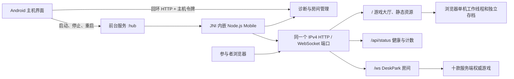

# LAN Game Hub 架构

## Android

- Java 原生界面包含服务、游戏、房间、设置和诊断。最低 API 26。APK 包含 ARM64、x86_64 两套运行库。
- 前台服务在独立的 `:hub` 进程运行。JNI 在专用线程调用 Node.js Mobile。应用私有目录保存静态资产、状态和日志。更换 APK 后重新提取资源。
- 采用 Node.js Mobile v18.20.4，因为固定发布包包含 Android ABI，桌游服务只用已验证的 Node 标准库和捆绑的纯 JS 依赖。上游的构建工具仍使用 Node 22.12+。桌面 Node 和 Android Bionic 运行库分别验证。
- 开启保持运行选项后，服务持有部分 CPU 唤醒锁及适用的 Wi‑Fi 锁。停止服务释放锁并退出 `:hub` 进程。重启会清除内存房间。实际在线状态以健康请求为准。
- 应用识别和轮询私有 IPv4 地址，优先展示 Wi‑Fi/热点接口，多地址可切换。邀请使用二维码和完整 URL。互联所需端口由主机配置，浏览器从同一端口下载客户端并连入房间。

## Web 与桌游

- `/` 根入口直接运行改造过的 DeskPark React 客户端。大厅、身份编辑、建房设置、等待房间、游戏桌面和结算都在同一应用。页面通过 hash 路由切换，无嵌套网页。
- 大厅按类别筛选。所有桌游共享玩家资料、设置、房间入口、基础按钮、表单、弹层、提示和主题。保留原棋牌桌面、棋谱、聊天、游戏项设置和分配座位的规则。
- `/ws` 复用 DeskPark 服务器权威 `Hub → Room → Table`，服务端校验动作、分发私有视图、管理超时和托管。浏览器重连用本地随机令牌恢复座位，空房按宽限期回收。单人对局在浏览器 Web Worker 内执行和存档。
- 色板、组件圆角、字号及间距为网页和 Android 共用的设计规范。棋牌桌可使用墨绿、黛蓝、酒红或石墨主题。网页使用系统字体和现有桌游资源。

## 网络和运维

- 仅接受局域网及回环连接。校验请求 Host 和 WebSocket Origin。浏览器无公网发现或转发入口。静态服务限制在指定资产根，管理接口仅接受本机带主机令牌的请求。
- 限制全局和单 IP 的连接数、活跃房间、WebSocket 帧、消息频率和慢客户端发送缓冲。服务会拒绝错误房间码、无权开始游戏、无效昵称/聊天内容与非法动作。
- 网页请求由 CSP 约束为同源资源及同源 WebSocket。应用禁用生产环境的云模型入口与服务代理，电脑玩家和棋类导师走本地逻辑。
- 诊断展示 HTTP、WebSocket 升级、活动连接、最近日志和实时 RSS。管理员可解散房间。停止、系统回收或重启服务时，活跃对局属于内存状态。

## 风险与边界

| 项目 | 当前处理 |
| --- | --- |
| 版本与 16 KiB 页 | Node.js Mobile 18.20.4 已停止维护，预编译 ELF 为 4 KiB 段对齐。本版用于调试和局域网试用。ARM64 及严格 16 KiB 页系统需要单独验证或更新运行库。 |
| Wi‑Fi、热点、休眠 | 需 Android 实体机覆盖厂商电源策略、热点休眠、Wi‑Fi 客户端隔离和多网卡切换。服务按健康检查展示状态，系统可以中断连接。 |
| 普通 HTTP | 当前使用可信本地网络内的 HTTP/WS。浏览器可用备用方式复制链接。私密数据和权限不依赖公网入口。 |
| 外部棋类引擎 | APK 保留桌游规则、内置电脑玩家及导师回退。可选 Stockfish/Wasm 的再分发安排需另外核对。 |
| 多游戏适配 | 当前通用大厅对接 DeskPark 的房间服务。新增独立游戏需要绑定自己的路由协议、成员、权限、清理逻辑和端到端测试。 |

## 0.2.0 定时竞技与可选单机模块

- 流光蛇场使用游戏引擎的 `realtime` 模式。局面每 120 ms 在服务端推进。输入只更新当前座位的转向与限时加速，广播沿用 `/ws` 的 `game` 帧及已有身份和房间权限。对局结束或房间关闭时停止定时器。触屏手机和电脑浏览器看到同一份排名与地图。客户端 Canvas 插值绘制，服务端只做格点逻辑。
- 单机蛇场使用同一规则和定时器，电脑玩家在本地运行。实时练习不会覆盖已保存的棋牌对局。
- 可选的 pvz_perf 离线 Web 包在构建时由 `scripts/stage-pvz.mjs` 校验并放入 `/games/pvz/`。服务端只有检测到模块标记和资源文件才将其写入 `/api/status`，大厅相应显示单人入口。通过独立同源页面进入并返回统一大厅，无独立服务端和端口。请使用可信、允许本地部署的上游包。
